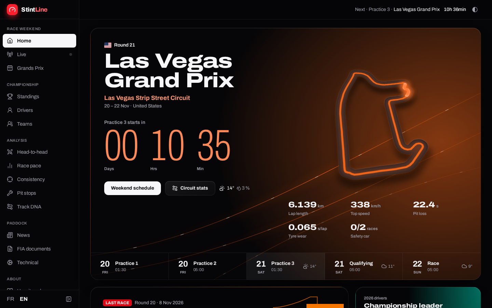
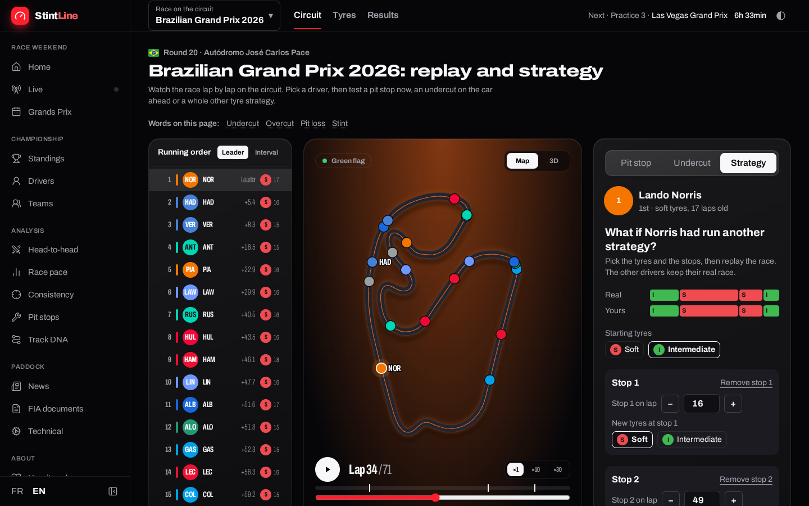
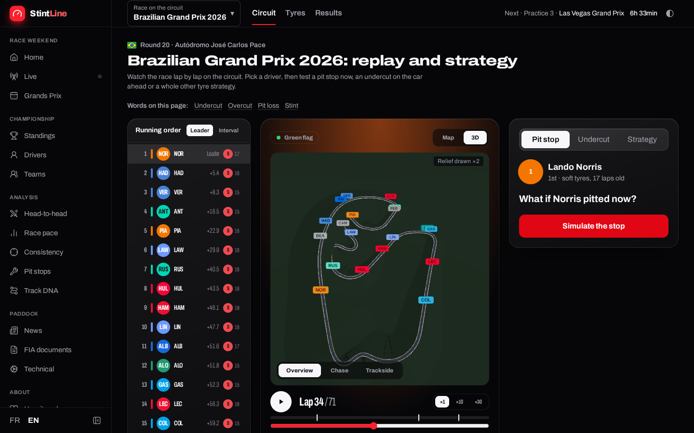
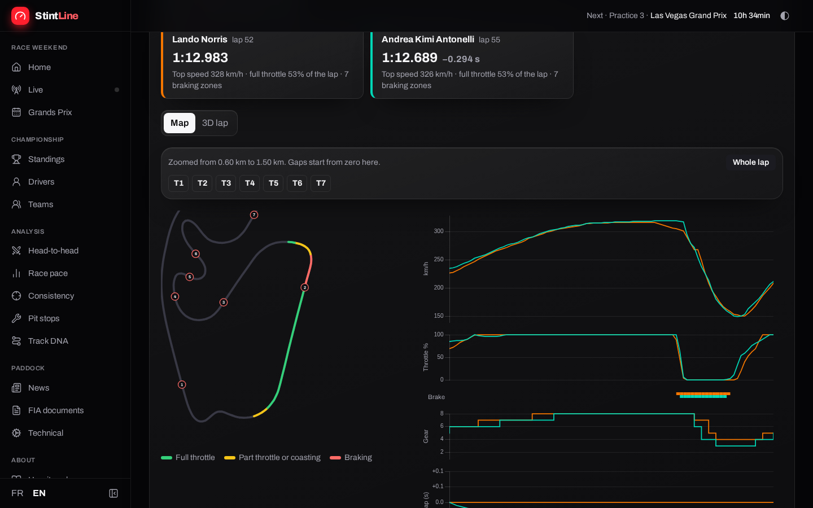
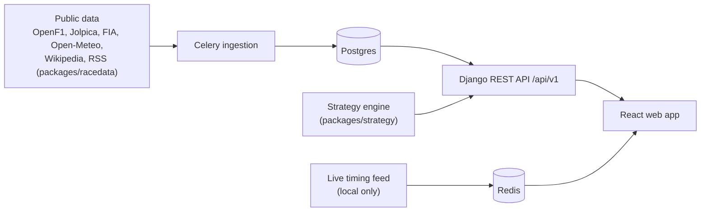

# StintLine

[](https://github.com/CafeurOff/stintline/actions/workflows/ci.yml)
[](LICENSE)


StintLine is a Formula 1 site built on public timing and results data. It replays recent races on the real circuit, explains the strategy behind them, and covers every Grand Prix since 1950. It is written for casual fans first, with detailed charts one click further. It is unofficial (see [Disclaimer](#disclaimer)).



## What it does

- **Race replay on the circuit** (2023 onwards): cars move along the real track outline next to a timing tower with gaps and tyres, on a map or in 3D on the circuit's relief.
- **Strategy simulators**: where a car rejoins if it pits now, undercut and overcut against a rival, and a whole race replayed with another tyre strategy.
- **Race analysis**: positions and gaps lap by lap, lap times, tyre strategies, sectors, and fastest-lap telemetry with a 3D view.
- **Archive since 1950**: results, qualifying, driver and team careers, standings, and who can still win the title.
- **Analysis pages**: teammate head-to-heads, race pace, consistency, pit stops and a profile of each circuit.
- **Paddock**: FIA documents and stewards' decisions, linked to drivers and laps.
- **News**: race reports written from the data, and headline links to public sources.
- **Live mode** on your own computer: running order, cars on the circuit, team radio and race control.

The site is in English and French, works on phones, and has light and dark themes. Every chart can be shared as a link, a PNG or CSV.







Screenshots are taken with official media blocked, so current drivers appear as coloured initials.

## Quick start

Prerequisites: [uv](https://docs.astral.sh/uv/) ≥ 0.9, Node ≥ 22.12 with pnpm 10, Docker with Compose v2.

```bash
git clone https://github.com/CafeurOff/stintline.git && cd stintline
make setup   # Python and JS dependencies, Playwright Chromium, git hooks, .env
make up      # Postgres, Redis, API, Celery worker and beat, web
make seed    # three 2025 races from recorded fixtures, no network (in another terminal)
```

Open http://localhost:5173. The API docs are at http://localhost:8000/api/docs/.

To load real data instead of the demo races:

| Data | Command | Time |
| --- | --- | --- |
| A season with full timing (2023 onwards) | `uv run python apps/api/manage.py ingest --season 2025 --sync` | hours: OpenF1's free tier allows 30 requests per minute |
| Results, qualifying and standings since 1950 | `uv run python apps/api/manage.py ingest_history` | a few hours, resumable |

Once running, the Celery worker imports each race after it finishes. `make help` lists every target.

The public replay-only instance runs at <https://stintline.omexis.fr> (ADR 0027). `make demo-up` runs the production images in replay-only mode on any machine ([`docs/deploy.md`](docs/deploy.md)).

## Architecture



| Directory | Contents |
| --- | --- |
| `apps/api` | Django 5.2, Django REST Framework, Celery, Channels (Python 3.13) |
| `apps/web` | React 19, TypeScript, Vite, Tailwind 4, TanStack Query, visx |
| `packages/racedata` | Data providers, rate-limited HTTP client, recorded fixtures |
| `packages/strategy` | Strategy engine: numpy and scipy, no Django, no I/O |
| `packages/api-types` | TypeScript types generated from the OpenAPI schema |

Only `racedata` calls external services. Decisions are recorded as ADRs in [`docs/adr`](docs/adr), and [`docs/architecture.md`](docs/architecture.md) describes the data flow.

## Strategy model

The engine removes laps that do not reflect race pace (lap 1, pit laps, safety car, outliers), corrects lap times for fuel, fits tyre degradation per compound, and measures the pit loss of each circuit from the race's own stops. From these it predicts where a car rejoins after a stop, with a probability for each position.

It is backtested on real 2025 races. Each green-flag stop is predicted with the pit loss measured on the other stops of the race. Parameters were tuned on three races only:

| Races | Stops | Mean error (positions) | Within ±1 position |
| --- | --- | --- | --- |
| Tuning: Bahrain, Hungary, Italy | 76 | 0.88 | 74 % |
| Held out: six other races | 155 | 0.86 | 79 % |

Every assumption, its default and its justification are in [`docs/model.md`](docs/model.md) and on the site's **How it works** page.

## Data sources and licences

| Source | Used for | Terms |
| --- | --- | --- |
| [OpenF1](https://openf1.org) | Timing, stints, pit stops, race control, telemetry, team radio (2023 onwards) | Free community API |
| [Jolpica](https://github.com/jolpica/jolpica-f1) | Results, qualifying, standings, biographies (1950 onwards) | Free, open source |
| [fia.com](https://www.fia.com) documents | Stewards' decisions, technical documents | © FIA; PDFs relayed, never stored |
| [Open-Meteo](https://open-meteo.com) | Weather forecasts | CC BY 4.0, credited where shown |
| Wikipedia / Wikimedia Commons | Driver portraits | Free licences, author and licence shown |
| Public RSS feeds | Headlines | Title and link only |

Details, rate limits and known data gaps are in [`docs/data-sources.md`](docs/data-sources.md). The code is under the [MIT licence](LICENSE); the data stays under its sources' terms.

## Limits

- **Live mode is local only.** The official timing feed is for personal use and does not answer cloud servers, so a public deployment only replays finished races.
- **Timing starts in 2023.** Older seasons have results and standings, but no replay or strategy figures.
- **Data gaps**: fastest-lap ranks only from 2004, qualifying mostly from 1994, no pit-stop rows for the first six races of 2023. Pages say so instead of guessing.
- **The model** assumes rivals do not react to a simulated stop, and does not model the field bunching up behind a safety car.

## Contributing

See [`CONTRIBUTING.md`](CONTRIBUTING.md). `make test-fast` runs every unit test in about 20 seconds, `make check` runs every check before a pull request.

## Disclaimer

StintLine is an unofficial project, not associated with Formula 1, the FIA or any Formula 1 team. F1, FORMULA ONE, FORMULA 1 and related marks are trademarks of Formula One Licensing B.V. No team logos are used. Official driver portraits and car renders, when enabled, are linked from their original URLs and never stored or redistributed.
