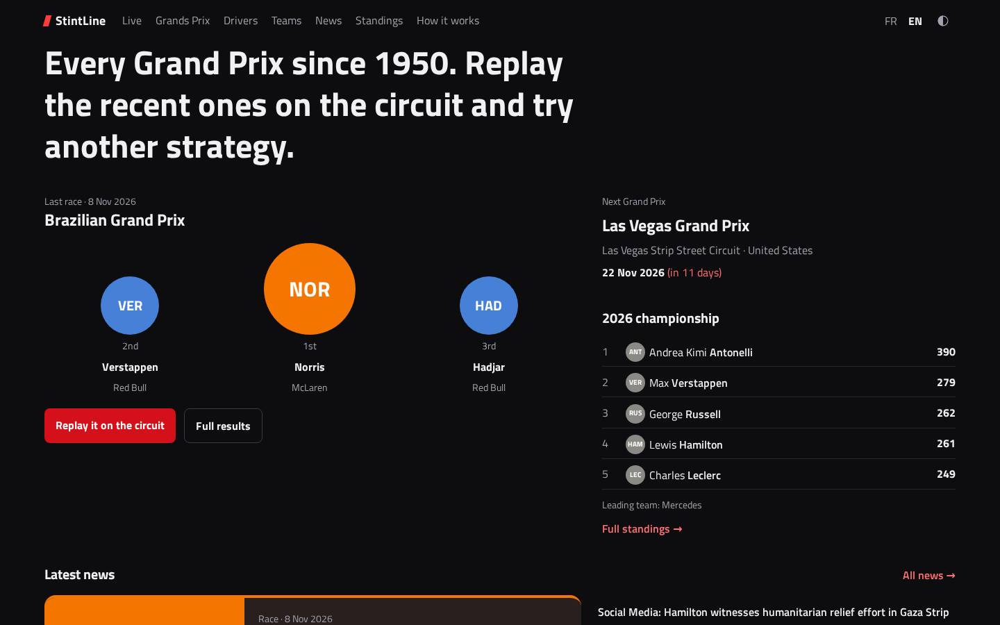
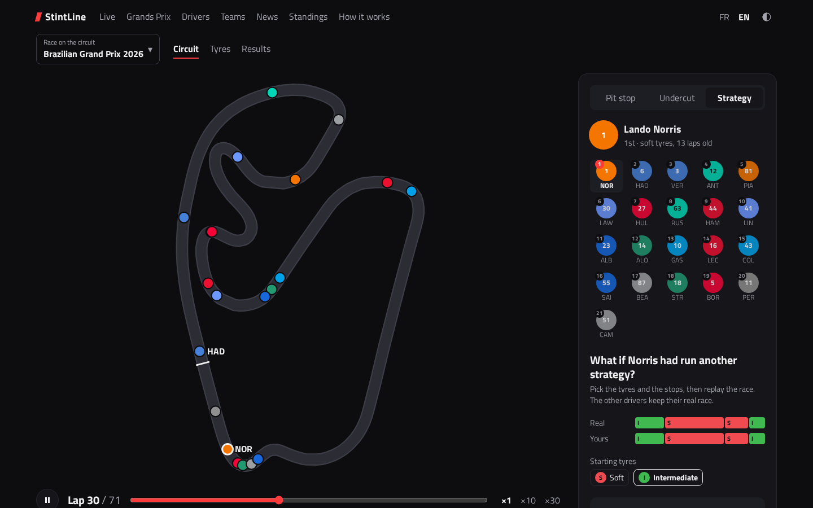
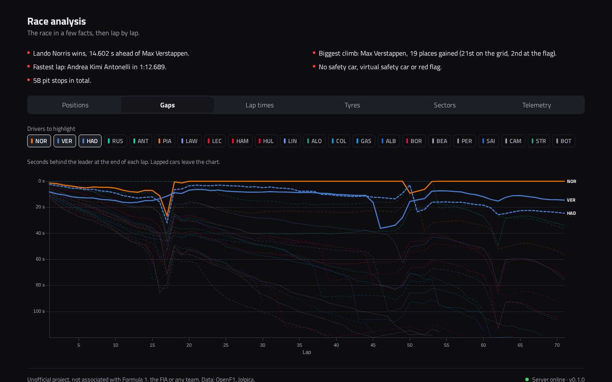
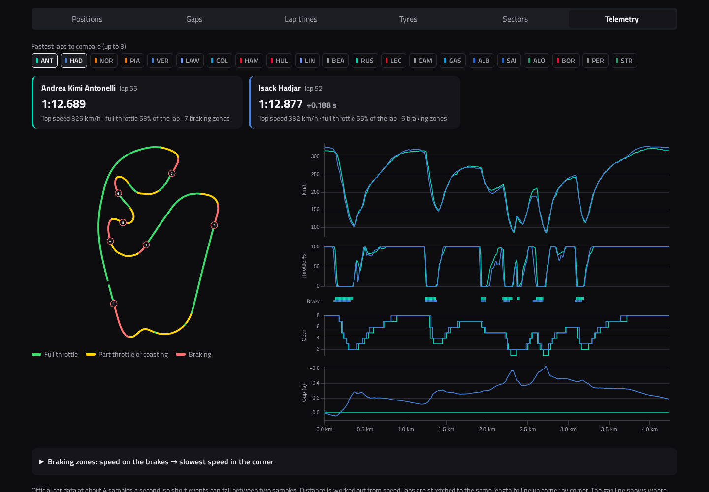
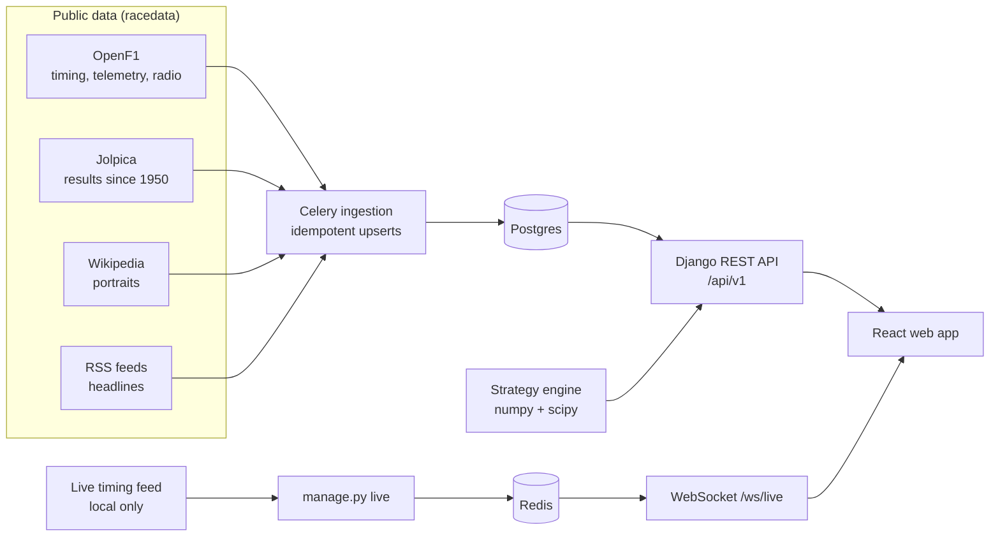

# StintLine

**Every Grand Prix since 1950, and the strategy behind the recent ones, shown on the circuit.**

StintLine is a hub for Formula 1 fans built on public timing and results data. Replay a race lap by lap with the real cars on the real track. Ask "what if he had pitted now?", test an undercut, or run the whole race again with another tyre strategy. Then dig into lap charts, gaps, sectors and fastest-lap telemetry. Casual fans get plain answers first. The detailed charts are one click further.



## What you can do

| | |
| --- | --- |
| **Replay a race on the circuit** | The cars move along the real track outline, lap by lap, at ×1, ×10 or ×30. Pick a driver to see their tyres and gaps. |
| **"What if he pitted now?"** | Places the car where it would rejoin after a stop, with a ghost car and the probability of each position. |
| **Undercut and overcut** | Lap-by-lap gain of stopping first against a rival, from fitted tyre wear and the circuit's pit loss. |
| **Replay a whole race with another strategy** | Change one car's stops and compounds. The other drivers keep their real race, and you get the finishing-position chances. |
| **Race analysis** | Key facts, positions and gaps lap by lap, lap times, tyre strategies, best sectors, top speeds. |
| **Telemetry** | Compare fastest laps: speed, throttle, brake, gear and the gap along the lap, drawn on the circuit with braking zones. |
| **Every Grand Prix since 1950** | Results, qualifying, grids, driver and team careers, championship tables with the title-fight chart. |
| **News** | Race reports written from the data (in English and French) and headline links to public sources. |
| **Live mode (local)** | Follows the official timing feed from your own computer: running order, cars on the circuit, team radio, race control, TV delay. |

The interface is bilingual (English and French), works on phones, and has a light and a dark theme.







## Quick start

Prerequisites: [uv](https://docs.astral.sh/uv/) ≥ 0.9, Node ≥ 22.12 with pnpm 10, Docker with Compose v2.

```bash
make setup   # Python and JS dependencies, Playwright Chromium, git hooks, .env
make up      # Postgres, Redis, API, Celery worker and beat, web
```

- Web: http://localhost:5173
- API: http://localhost:8000/api/v1/health, interactive docs at http://localhost:8000/api/docs/

On its first start the Celery worker imports the current season, then every race as soon as it finishes. To fill the database:

| Data | Command | Time |
| --- | --- | --- |
| Demo races from recorded fixtures, no network | `make seed` | seconds |
| A season with full timing (2023 onwards) | `uv run python apps/api/manage.py ingest --season 2025 --sync` | long: OpenF1's free tier allows 30 requests per minute |
| Results, qualifying and standings since 1950 | `uv run python apps/api/manage.py ingest_history` | a few hours, can be resumed |

`make help` lists every target. `CLAUDE.md` is the full reference for commands, conventions and known pitfalls.

## The strategy model

The engine (`packages/strategy`) is pure Python with numpy and scipy. It has no Django and no I/O, and it is tested on synthetic races with known ground truth.

1. **Clean laps.** It drops lap 1, in and out laps, laps under safety car, virtual safety car or red flag, and outliers.
2. **Fuel correction.** 0.033 s per kg of fuel burnt, supported by a sensitivity check (lower values give tyres that get faster with age at Monza).
3. **Tyre degradation.** A pooled slope per compound with a 95 % interval. Stints shorter than the minimum are flagged as low confidence.
4. **Pit loss per circuit,** estimated from the race's own stops (time lost in the pit lane compared with a racing lap).
5. **Pit exit and undercut.** It projects gaps after a stop and gives position probabilities from the lap-time noise.

**Backtest on real 2025 races.** Each green-flag stop is predicted with the pit loss estimated from the race's *other* stops, then compared with the position at the end of the out-lap. Parameters were tuned only on Bahrain, Hungary and Italy. Six races were never used for tuning:

| Set | Stops | Mean error (positions) | Within ±1 position | Keep-position baseline |
| --- | --- | --- | --- | --- |
| Tuning (3 races) | 76 | 0.88 | 74 % | 6.07 |
| **Held out (6 races)** | 155 | **0.86** | **79 %** | 4.68 |

These are the "blind" figures: the model assumes rivals stay out. Given the rivals' real stops, the held-out error falls to 0.66 and 90 % of predictions land within one position. Assumptions, methods, degradation tables and limitations are in [`docs/model.md`](docs/model.md), and in the app under **How it works**.

## Architecture



| Part | Stack |
| --- | --- |
| `apps/api` | Django 5.2, Django REST Framework, drf-spectacular, Celery, Channels, Python 3.13 |
| `apps/web` | React 19, TypeScript (strict), Vite, Tailwind 4, TanStack Query, React Router, visx |
| `packages/racedata` | Data providers behind typed protocols, rate-limited HTTP client with retry and cache, recorded fixtures |
| `packages/strategy` | Strategy engine: laps, fuel, degradation, pit loss, pit exit, undercut, what-if, telemetry, backtest |
| `packages/api-types` | TypeScript types generated from the OpenAPI schema |

Only `racedata` talks to the network. Views and the strategy engine never call upstream APIs. Design decisions are recorded as ADRs in [`docs/adr`](docs/adr). See also [`docs/architecture.md`](docs/architecture.md) and [`docs/data-sources.md`](docs/data-sources.md).

## Quality

```bash
make check   # ruff, mypy --strict, ESLint, tsc, pytest, Vitest, OpenAPI and types drift
```

- Coverage gates: strategy engine ≥ 90 %, data providers ≥ 85 %, API ≥ 80 %.
- No network in tests: upstream responses are recorded fixtures.
- Playwright covers the main journeys: home → last race → pit-stop simulation, undercut, tyres and model pages in French, theme, driver careers.
- CI runs on every push. Commits follow Conventional Commits.

## Public demo (replay only)

The live mode follows the official timing feed. That feed only answers home connections and is for personal use, so a public deployment shows replays of finished races. The live page then points to the last race. A production stack with nginx, uvicorn, Celery and Postgres is ready to deploy:

```bash
cp infra/demo.env.example infra/demo.env   # set the secrets and the host name
make demo-up                               # http://localhost:8080
make demo-load                             # optional: copy your local database into it
```

Put a TLS reverse proxy in front of it on a real server. Details are in [`docs/deploy.md`](docs/deploy.md).

## Data sources and limits

- [OpenF1](https://openf1.org) for timing, stints, pit stops, race control, weather, positions, team radio and telemetry, from 2023. Free tier: 3 requests/s and 30/min.
- [Jolpica](https://github.com/jolpica/jolpica-f1) (the Ergast successor) for results, qualifying, standings and biographies since 1950.
- Wikipedia / Wikimedia Commons for freely licensed driver portraits, always shown with author and licence.
- Public RSS feeds for headlines. Only the title and a link are kept, never article text or images.
- Gaps in the data: fastest-lap ranks only from 2004, qualifying mostly from 1994, no pit-stop rows for the first six races of 2023. Pages say so instead of guessing.

## Disclaimer

StintLine is an unofficial project. It is not associated in any way with Formula 1, the FIA, or any Formula 1 team. F1, FORMULA ONE, FORMULA 1 and related marks are trademarks of Formula One Licensing B.V. All other trademarks belong to their respective owners. No team logos are used. Official driver portraits and car renders, when enabled, are only linked from their original URLs and never stored or redistributed.

## License

[MIT](LICENSE)
