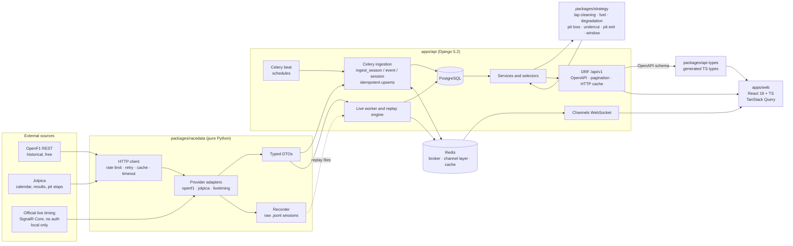

# Architecture

StintLine ingests public timing data into its own database, runs a pure-Python strategy engine on it, and serves the results through a versioned REST API, a WebSocket channel and a React frontend.

## Overview

## Components

| Component | Responsibility | Must not |
| --- | --- | --- |
| `packages/racedata` | Talk to upstream sources, normalise payloads into typed DTOs (UTC datetimes, explicit units), record raw live sessions | Know about Django or the database |
| `apps/api` ingestion | Map DTOs to models with natural-key upserts. Schedule ingestion | Call upstream directly (always via `racedata`) |
| PostgreSQL | Source of truth for everything served | — |
| `packages/strategy` | Deterministic models and simulations on plain inputs | Do I/O, import Django or `racedata` |
| `apps/api` REST | Expose data and strategy results under `/api/v1/`, documented with OpenAPI | Compute strategy logic inline in views |
| Live worker | Consume the live feed (or a recording, in replay mode), persist new laps, recompute strategy each lap, publish to Redis | Run on the public demo server against the live feed |
| Channels | Push session updates to subscribed browsers, with a configurable display delay | — |
| `apps/web` | Session picker, strategy timeline, degradation, simulator, model page, live/replay view | Call upstream APIs or redeclare API types |

## Runtime topology (docker compose)

`postgres`, `redis`, `api` (ASGI: Django + Channels), `worker` (Celery), `beat` (Celery beat), `web` (Vite dev server in dev, static build behind nginx in prod). One command: `make up`.

## Key flows

1. **Historical ingestion.** `ingest_season(2025)` → `ingest_event` per round → `ingest_session` per session. This fetches OpenF1 laps, stints, pit, race control and weather, plus Jolpica results and pit stops, then upserts. Re-running is a no-op.
2. **Strategy query.** `GET /api/v1/sessions/{id}/undercut?attacker=…&defender=…&lap=…` → selector loads cleaned laps and stints → strategy engine fits degradation and pit loss → simulation → JSON with the expected gain and an uncertainty interval.
3. **Live (local).** Live worker subscribes to the SignalR topics (TimingData, TimingAppData, TrackStatus, RaceControlMessages, WeatherData, LapCount…). On each completed lap it upserts, recomputes, and broadcasts on `session.<id>`. The browser applies the user's TV delay.
4. **Replay (demo).** The replay engine reads stored laps (or a recorded `.jsonl`) and emits the same messages at ×1–×20 speed, so the frontend cannot tell replay from live.

See `docs/data-sources.md` for source limits and terms, and the ADRs for the reasoning behind these choices.
