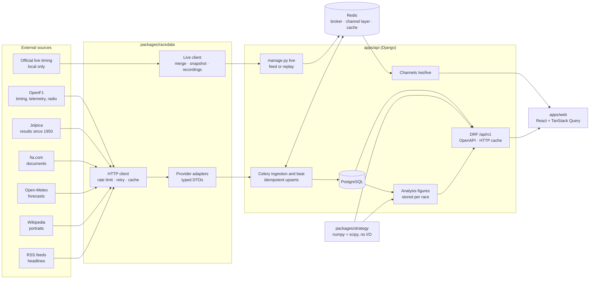

# Architecture

StintLine imports public timing and results data into its own database, runs a pure-Python strategy engine on it, and serves the results through a versioned REST API, a WebSocket channel and a React app.

## Overview

## Components

| Component | Responsibility | Must not |
| --- | --- | --- |
| `packages/racedata` | Talk to upstream sources, normalise payloads into typed DTOs (UTC datetimes, explicit units), follow and record the live feed | Know about Django or the database |
| `apps/api` ingestion | Map DTOs to models with natural-key upserts, on a schedule and after each Grand Prix | Call upstream directly (always through `racedata`) |
| PostgreSQL | Source of truth for everything served | — |
| `packages/strategy` | Deterministic models and simulations on plain inputs | Do I/O, import Django or `racedata` |
| `apps/api` analysis | Run the engine once per imported race and store the figures the season and circuit pages read (ADR 0017) | Run the engine over a whole season inside a request |
| `apps/api` REST | Expose data and strategy results under `/api/v1/`, documented with OpenAPI | Compute strategy logic in views |
| Live process | Consume the live feed or a recording, build a snapshot with the pit-now answer, keep the latest in Redis and broadcast it once per second (ADR 0011) | Write to Postgres, or follow the live feed on a public server |
| `apps/web` | Pages, charts and simulators, in English and French | Call upstream services or redeclare API types |

Two API views may reach upstream on request, both through `racedata` and a cache: the FIA PDF relay (ADR 0018) and the Wikipedia portrait relay (ADR 0024).

## Runtime topology

`make up` starts `postgres`, `redis`, `api` (ASGI: Django and Channels), `worker` (Celery, one process because rate limits are enforced in-process), `beat` (Celery beat) and `web` (Vite dev server). `make live` adds the live process.

The public demo (`infra/docker-compose.demo.yml`, `make demo-up`) runs the production images of the same services behind nginx, with a one-shot `migrate`, and never runs `live` (replay only, ADR 0002). See [`deploy.md`](deploy.md).

## Key flows

1. **Import.** `refresh_recent` runs every 30 minutes: it refreshes the calendar, imports each finished race or sprint (OpenF1 timing and Jolpica results), then builds its analysis figures and telemetry. Re-running is a no-op.
2. **Strategy query.** `POST /api/v1/sessions/{id}/simulate/undercut` → the race context (cleaned laps, degradation fits, pace model, pit loss) is built once per session and cached → the simulation runs → JSON with the expected gain and an uncertainty interval.
3. **Live (local).** `manage.py live` subscribes to the SignalR topics, merges their updates, keeps what the feed shows only once (pit-lane times, weather per lap) and publishes a snapshot at most once per second to the cache and the `live` Channels group. `GET /api/v1/live` gives the state; `/ws/live` streams the snapshots, and the browser applies the user's TV delay.
4. **Replay.** `manage.py live --replay FILE --speed N` plays a recording (or one rebuilt from a stored race by `live_demo`) through the same publisher, so the web app cannot tell a replay from a live session.
5. **News.** Beat reads the news feeds every 30 minutes and stores headlines (title and link). Race reports are built from stored data and written in English or French by the web app (ADR 0012).
6. **Page heads.** Any path that is not an asset is rendered by the API from the built `index.html`, with the page's title, description, canonical address, language alternates and structured data, or a real 404 (ADR 0025).

See [`data-sources.md`](data-sources.md) for source limits and terms, and the [ADRs](adr/) for the reasoning behind these choices.
